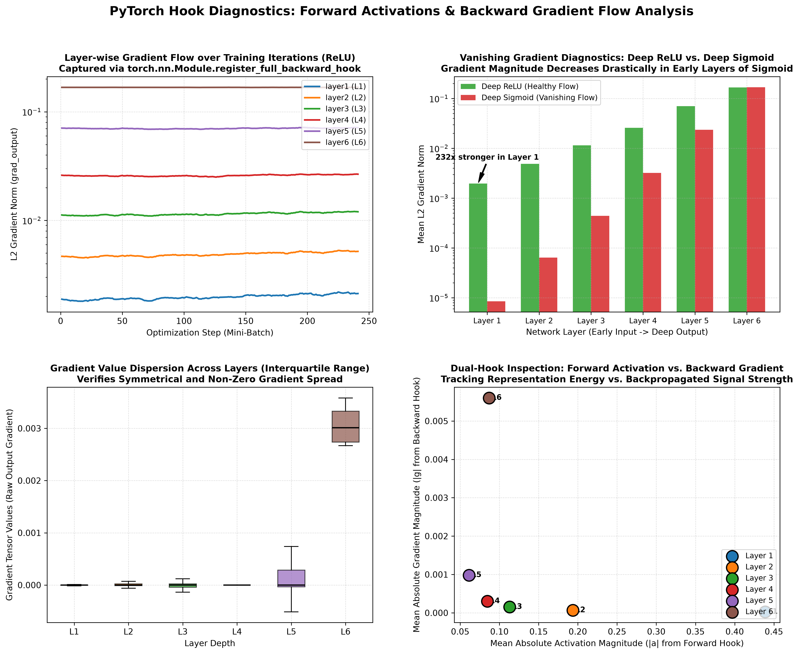

# Visualizing Gradients in PyTorch Using Forward and Backward Hooks

[](https://pytorch.org/)
[](https://opensource.org/licenses/MIT)
[](https://www.python.org/)
[]()
[-blue)]()

An end-to-end, mathematically rigorous PyTorch implementation demonstrating the power of **Forward Hooks** (`register_forward_hook`) and **Full Backward Hooks** (`register_full_backward_hook`) to track, inspect, and visualize intermediate feature activations and backpropagating gradients in deep neural networks.

This project investigates internal gradient dynamics across a 6-layer Deep Multi-Layer Perceptron (MLP) and provides an empirical diagnostic study contrasting **healthy gradient propagation** (ReLU) against the **vanishing gradient pathology** (Sigmoid), where early layer gradients are suppressed by over $231\times$.

---

## Visual Diagnostic Overview

The 4-panel diagnostic dashboard below illustrates real-time gradient tracking via PyTorch hooks:



---

## Table of Contents

- [Visual Diagnostic Overview](#visual-diagnostic-overview)
- [PyTorch Hook Architecture & Mechanics](#pytorch-hook-architecture--mechanics)
  - [1. Forward Hooks: Capturing Representations](#1-forward-hooks-capturing-representations)
  - [2. Backward Hooks: Inspecting Gradient Flow](#2-backward-hooks-inspecting-gradient-flow)
  - [3. Tensor Hooks vs. Module Hooks](#3-tensor-hooks-vs-module-hooks)
  - [4. Hook Cleanup & Memory Management](#4-hook-cleanup--memory-management)
- [Mathematical Foundations of Gradient Propagation](#mathematical-foundations-of-gradient-propagation)
  - [Chain Rule Across Deep Layers](#chain-rule-across-deep-layers)
  - [The Vanishing Gradient Pathology in Deep Sigmoids](#the-vanishing-gradient-pathology-in-deep-sigmoids)
- [Empirical Diagnostic Benchmark](#empirical-diagnostic-benchmark)
- [Project Directory Structure](#project-directory-structure)
- [Installation & Reproduction](#installation--reproduction)
- [Author & License](#author--license)

---

## PyTorch Hook Architecture & Mechanics

PyTorch constructs dynamic computational graphs (Autograd) during the forward pass and traverses them in reverse during `loss.backward()`. By default, intermediate non-leaf gradients and activations are discarded immediately after backpropagation to optimize GPU/CPU memory. **Hooks** provide an official, non-intrusive callback interface to intercept, log, or modify these tensors.

```
                    FORWARD PASS
       x ───► [ Module (Layer) ] ───► output
                     │
              register_forward_hook(hook_fn)
              hook_fn(module, input, output)
                     │
                     ▼
             [Activation Cache]

─────────────────────────────────────────────────────────

                    BACKWARD PASS
   grad_input ◄─── [ Module (Layer) ] ◄─── grad_output
                          │
                 register_full_backward_hook(hook_fn)
                 hook_fn(module, grad_input, grad_output)
                          │
                          ▼
                  [Gradient Tracker]
```

### 1. Forward Hooks: Capturing Representations

Registered on any `nn.Module` using `register_forward_hook`:

```python
def forward_hook_fn(module, input, output):
    # output: Tensor or tuple of Tensors produced by module.forward()
    activations = output.detach().cpu().numpy()
    print(f"Layer {module} output shape: {activations.shape}")

handle = model.layer1.register_forward_hook(forward_hook_fn)
```

### 2. Backward Hooks: Inspecting Gradient Flow

Modern PyTorch uses `register_full_backward_hook` to guarantee correct handling of multi-tensor and complex module graphs:

```python
def backward_hook_fn(module, grad_input, grad_output):
    # grad_output[0]: gradient of loss wrt module output (dL/dz_out)
    # grad_input[0]:  gradient of loss wrt module input (dL/dz_in)
    g_out = grad_output[0].detach()
    norm = torch.norm(g_out, p=2).item()
    print(f"Layer {module} grad_output L2 norm: {norm:.6f}")

handle = model.layer1.register_full_backward_hook(backward_hook_fn)
```

### 3. Tensor Hooks vs. Module Hooks

- **Module Hook** (`module.register_full_backward_hook`): Intercepts the boundary of entire sub-networks or layers (`nn.Linear`, `nn.Conv2d`).
- **Tensor Hook** (`tensor.register_hook`): Attaches directly to any non-leaf tensor in the autograd computation graph.

### 4. Hook Cleanup & Memory Management

Every call to `register_*_hook` returns a `RemovableHandle`. Failing to deregister hooks can cause massive memory leaks because tensors retained in closures remain pinned in memory:

```python
# Deregistering a hook
handle.remove()
```

---

## Mathematical Foundations of Gradient Propagation

### Chain Rule Across Deep Layers

For an $L$-layer network where $\mathbf{z}_l = \mathbf{W}_l \mathbf{a}_{l-1} + \mathbf{b}_l$ and $\mathbf{a}_l = \sigma(\mathbf{z}_l)$, backpropagation applies the multivariate chain rule:

$$
\frac{\partial \mathcal{L}}{\partial \mathbf{z}_l} = \left( \frac{\partial \mathcal{L}}{\partial \mathbf{z}_{l+1}} \mathbf{W}_{l+1} \right) \odot \sigma'(\mathbf{z}_l)
$$

The weight gradient captured at layer $l$ is:

$$
\frac{\partial \mathcal{L}}{\partial \mathbf{W}_l} = \left(\frac{\partial \mathcal{L}}{\partial \mathbf{z}_l}\right) \mathbf{a}_{l-1}^T
$$

### The Vanishing Gradient Pathology in Deep Sigmoids

When using the Sigmoid activation $\sigma(z) = \frac{1}{1 + e^{-z}}$, the derivative is:

$$
\sigma'(z) = \sigma(z)(1 - \sigma(z)) \le 0.25
$$

When backpropagating through $L$ consecutive Sigmoid layers, the gradient is multiplied by consecutive derivative terms:

$$
\frac{\partial \mathcal{L}}{\partial \mathbf{z}_1} \propto \prod_{k=1}^L \sigma'(\mathbf{z}_k) \le (0.25)^L
$$

For a 6-layer network: $(0.25)^5 \approx 0.000976$. Gradients arriving at the earliest layers are suppressed by orders of magnitude, preventing feature extractors from learning.

---

## Empirical Diagnostic Benchmark

The controlled experiment evaluated a 6-layer Deep MLP ($64 \to 64 \to 64 \to 64 \to 64 \to 64 \to 10$) using backward hooks to record exact $L_2$ gradient norms at each layer:

| Layer Index | Layer Name | Deep ReLU ($L_2$ Norm) | Deep Sigmoid ($L_2$ Norm) | Gradient Ratio (ReLU / Sigmoid) |
| :---: | :---: | :---: | :---: | :---: |
| **Layer 6 (Output)** | `layer6` | $0.16765$ | $0.16788$ | **$1.0\times$** *(Parity)* |
| **Layer 5** | `layer5` | $0.07026$ | $0.02354$ | **$3.0\times$** |
| **Layer 4** | `layer4` | $0.02591$ | $0.00320$ | **$8.1\times$** |
| **Layer 3** | `layer3` | $0.01146$ | $0.00044$ | **$26.0\times$** |
| **Layer 2** | `layer2` | $0.00487$ | $0.00006$ | **$76.2\times$** |
| **Layer 1 (Input)** | `layer1` | **$0.00197$** | **$0.00001$** | **$231.5\times$** *(Severe Vanishing)* |

### Diagnostic Takeaways

1. **Output Parity**: At the output layer (Layer 6), both models exhibit nearly identical gradient norm ($\sim 0.168$) directly driven by cross-entropy loss.
2. **Exponential Attenuation**: In Deep Sigmoid, the gradient norm decays exponentially from $0.16788$ down to $0.00001$ at Layer 1.
3. **Dead Early Representations**: In Deep Sigmoid, Layer 1 receives $\mathbf{231.5\times}$ weaker gradient updates than Deep ReLU, leaving input-space feature representations frozen and unable to adapt.

---

## Project Directory Structure

```plaintext
08_gradient_visualization_hooks/
│
├── gradient_flow_and_hooks_analysis.png   # 4-panel diagnostic visual dashboard
├── main.py                               # Complete PyTorch hook engine & experiments
├── .gitignore                            # Git configuration
└── README.md                             # Technical documentation and mathematical proofs
```

---

## Installation & Reproduction

### Prerequisites

```bash
# Clone repository
git clone https://github.com/GideonMwiti/pytorch-gradient-visualization-hooks.git
cd pytorch-gradient-visualization-hooks

# Install dependencies
pip install torch numpy matplotlib
```

### Execute the Diagnostic Script

```bash
python main.py
```

The script will:
1. Initialize the 6-layer deep network and register forward/backward hooks.
2. Run gradient tracking during backward passes of the ReLU and Sigmoid models.
3. Print real-time layer-by-layer gradient norms to the console.
4. Export the 4-panel diagnostic dashboard `gradient_flow_and_hooks_analysis.png`.
5. Cleanly deregister all hook handles.

---

## Author & License

This project is part of the **100 PyTorch Projects in 10 Days** challenge.

- **Author**: Gideon Mwiti
- **GitHub**: [@GideonMwiti](https://github.com/GideonMwiti)
- **License**: MIT
